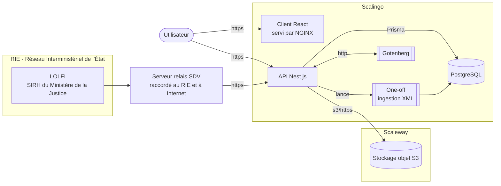

# Fondation

Donner au CSM (Conseil Supérieur de la Magistrature) les moyens d'un travail efficace et de qualité afin de concourir à la continuité du fonctionnement de l'institution judiciaire et de contribuer à une RH vertueuse du corps de la magistrature.

## Organisation du monorepo

Le projet est un workspace [pnpm](https://pnpm.io) composé de :

- [apps/api](./apps/api) : le back-end Nest.js + Prisma
- [apps/client](./apps/client) : le front-end React + Vite
- [apps/api-e2e](./apps/api-e2e) : les tests bout-en-bout de l'api
- [packages/lolfi](./packages/lolfi) : le générateur d'archives LOLFI des tests bout-en-bout et des données fictives du local et de staging

## Architecture



LOLFI est le SIRH du ministère de la Justice qui suit les carrières des magistrats. Ses
extractions XML sont la source des données de nomination. Le RIE n'étant pas connecté à
Internet, un serveur relais fourni par le prestataire SDV, raccordé aux deux réseaux,
transmet ces fichiers chiffrés à l'api.

Gotenberg convertit en PDF le HTML des documents produits par l'api (ordre du jour, PV et
notice de restitution). Il n'est pas déployé depuis ce dépôt mais depuis
[betagouv/fondation-gotenberg](https://github.com/betagouv/fondation-gotenberg) dans sa
propre application Scalingo `fondation-gotenberg`.

Le stockage objet, hébergé chez Scaleway et compatible S3, contient les pièces jointes ainsi
que les PDF générés, qui y sont mis en cache pour éviter de les reconstruire à chaque
consultation. En local, il est émulé par MinIO (voir l'installation).

## Installation et lancement

Toutes les commandes ci-dessous se lancent depuis la racine du dépôt.

1. Installation des dépendances

```bash
pnpm install
```

2. Copier le fichier `.env.example` vers `.env`

```bash
cp apps/api/.env.example apps/api/.env
```

Le fichier `apps/api/.env` (gitignoré) contient toutes les variables nécessaires pour démarrer
l'application localement. `DATABASE_URL` pointe vers un Postgres local lancé dans Docker
(étape 3), sur le port non-standard `5435` pour ne pas entrer en conflit avec un Postgres
déjà présent sur la machine.

3. Démarrer les services et la base de données

```bash
docker compose --file apps/api/test/docker-compose-test.yaml up -d   # Postgres :5435 + MinIO/S3 :9000 + Gotenberg :9091
pnpm --filter api prisma migrate deploy
```

Pour la base de test :

```bash
pnpm --filter api exec dotenvx run -f .env.e2e -f .env -- prisma migrate deploy
```

> [!WARNING]
> Il est très facile de lancer les tests sur la base locale par erreur. Toujours passer
> par les scripts du package.json de l'api (comme `start:e2e`), qui chargent `.env.e2e`
> avant `.env` pour cibler la base de test.

> [!NOTE]
> Postgres suit la version majeure de la production (17). Un changement de version repart d'une base
> vide, voir [docs/montee-de-version-postgres.md](./docs/montee-de-version-postgres.md).

4. Générer le code

```bash
pnpm --filter api prisma:generate   # client Prisma + requêtes TypedSQL
```

> [!IMPORTANT]
> `prisma generate --sql` se connecte à la base pour typer les requêtes de `prisma/sql/`.
> Postgres doit donc tourner et les migrations être appliquées (étape 3). Ce code n'est pas
> versionné, à relancer après chaque `pnpm install`.

5. Initialiser les buckets S3 (une seule fois)

```bash
node apps/api/scripts/init-buckets.js
```

6. Lancement de l'application

```bash
pnpm --filter api dev       # back sur :3000, Swagger sur /openapi
pnpm --filter client dev    # front sur :5173
```

7. Créer un utilisateur pour se connecter

```bash
pnpm --filter api build
pnpm --filter api exec node --env-file .env dist/cli user register \
  --email jean@example.fr \
  --firstname Jean \
  --lastname Moulin \
  --gender MALE \
  --role ADJOINT_SECRETAIRE_GENERAL --admin --technical
```

Le CLI demande ensuite le mot de passe. `--admin` donne le droit administrateur et `--technical` fait du
compte celui d'un membre de l'équipe Fondation. Les autres comptes se créent ensuite depuis l'écran
d'administration.

8. Charger les données fictives

L'application reste vide tant que l'archive LOLFI fictive n'est pas ingérée. La marche à suivre est
décrite dans la section [Données fictives](#données-fictives).

9. Accéder à l'application sur [http://localhost:5173](http://localhost:5173)

## Données fictives

Le local et staging ne contiennent aucune personne réelle. On y ingère une archive LOLFI fictive dont les
volumes sont calqués sur la prod. Elle se génère depuis la racine.

```bash
pnpm --filter lolfi generate:fictitious-archive
```

La commande écrit deux archives dans `packages/lolfi`. Elles s'envoient avec un compte administrateur sur
[/admin/lolfi](http://localhost:5173/admin/lolfi), dans cet ordre.

1. Envoyer `LOLFI_CSM_fictitious.zip`
2. Attendre la fin de son ingestion sur [/admin/ingestions](http://localhost:5173/admin/ingestions)
3. Envoyer `LOLFI_CSM_fictitious_departures.zip` (qui rend inactifs les magistrats partis comme dans la prod)

L'envoi sur staging, la remise à zéro et la manière de remesurer la prod sont décrits dans
[docs/donnees-fictives.md](./docs/donnees-fictives.md).

## Mesure d'audience

Le client envoie ses vues de page au Matomo mutualisé de beta.gouv, site `273`. Les URL sont
anonymisées avant l'envoi. Leurs identifiants sont remplacés par le nom du paramètre de route
(`/magistrats/:magistratId`), voir [apps/client/src/utils/matomo.ts](./apps/client/src/utils/matomo.ts).

Sans les variables `VITE_MATOMO_*`, la mesure est désactivée. Elles ne sont renseignées que dans
l'environnement `production` de GitHub. Rien n'est donc envoyé en local ni en recette.

## Tests

Les tests unitaires :

```bash
pnpm --filter api test
pnpm --filter client test
```

Les tests bout-en-bout de l'api ([apps/api-e2e](./apps/api-e2e)) démarrent l'api eux-mêmes. Ils
ont seulement besoin des services de l'étape 3 et de la base de test migrée.

```bash
pnpm --filter api-e2e test
```

### Playwright

Playwright teste le front contre un back lancé en mode test. Il sait démarrer ce back lui-même. Ses logs
sont cependant plus lisibles dans un terminal à part.

```bash
pnpm --filter api start:e2e
pnpm --filter client dev
pnpm --filter client playwright test --ui   # ou `test:e2e` pour un lancement sans interface
```

## Génération du SDK front

Les contrôleurs Nest produisent une spécification [OpenAPI](https://swagger.io/specification/), consultable
sur [/openapi](http://localhost:3000/openapi). [@hey-api/openapi-ts](https://heyapi.dev/openapi-ts) en tire
le SDK du front et celui des tests bout-en-bout. Le back doit tourner (étape 6) avant de lancer la
génération depuis la racine.

```bash
pnpm run openapi:generate
```

Le code généré est versionné et ne se modifie jamais à la main. Le front l'appelle depuis ses propres
hooks TanStack Query, dans [apps/client/src/queries](./apps/client/src/queries), selon les conventions de
[apps/client/CLAUDE.md](./apps/client/CLAUDE.md).

## Storybook

Le catalogue des composants du front est construit avec [Storybook](https://storybook.js.org/) :

```bash
pnpm --filter client storybook
```

Il est accessible sur [localhost:6006](http://localhost:6006). Une version en ligne est
déployée sur Scalingo à chaque push sur `develop` (lien disponible en interne).

Pour créer une story, voir le [guide Storybook](./apps/client/docs/storybook.md). Un guide
d'utilisation à destination du métier est intégré au Storybook (page "Guide / Bienvenue").

## Contribution

> [!NOTE]
> Les fichiers `CLAUDE.md` contiennent de nombreuses informations relatives au style utilisé dans
> le projet. [CLAUDE.md](./CLAUDE.md) couvre le transverse, [apps/api/CLAUDE.md](./apps/api/CLAUDE.md)
> le back-end et la base de données, [apps/client/CLAUDE.md](./apps/client/CLAUDE.md) le front-end. Ils
> s'adressent aux LLMs mais servent aussi de référence aux développeurs. Le projet suit aussi les principes
> de [cognitive-load](https://github.com/zakirullin/cognitive-load/blob/main/README.md).

Le front et le back ont chacun leur configuration [oxlint](https://oxc.rs/docs/guide/usage/linter) et
[oxfmt](https://oxc.rs/docs/guide/usage/formatter) (`.oxlintrc.json`, `.oxfmtrc.json`). La CI les vérifie
sur chaque pull request. La même vérification se lance en local depuis la racine.

```bash
pnpm run prepush
```

Le hook [husky](https://typicode.github.io/husky) `pre-push` la lance avant chaque push. Il s'installe avec
`pnpm install` et `git push --no-verify` le saute au besoin.

Une fois la pull request fusionnée dans `develop`, on déploie staging avec `bin/deploy-staging.sh`.

## Sécurité des dépendances

[pnpm-workspace.yaml](./pnpm-workspace.yaml) protège l'installation des attaques par supply chain
(cf. [SHAI-HULUD 2](https://www.cert.ssi.gouv.fr/actualite/CERTFR-2025-ACT-051/)). PNPM n'installe que
les versions du lockfile et attend 7 jours avant de proposer une nouvelle version. Seuls les paquets dont
la compilation ou le binaire natif l'exige exécutent leurs scripts d'installation (`postinstall`, etc.).
Ils sont listés dans `allowBuilds`.

> [!WARNING]
> Ces mesures n'empêchent pas la plus grande vigilance avant d'installer une dépendance.
> Chaque installation de dépendance doit être justifiée.
